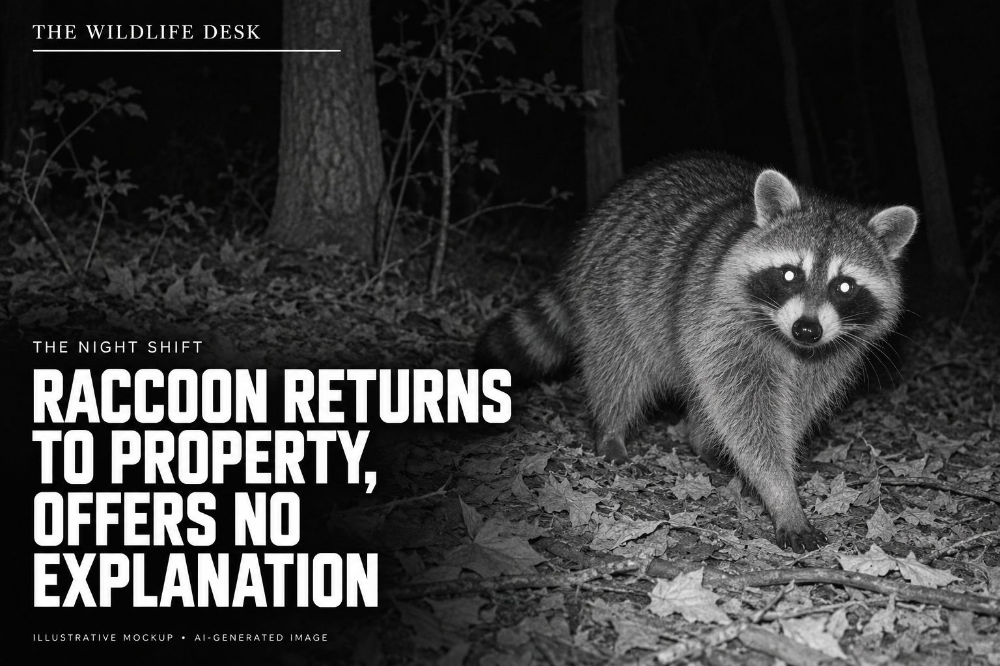

# The Wildlife Desk

**A local newsroom covering an extremely small jurisdiction.**



*Illustrative design mockup. The hero image is AI-generated. Published wildlife reports will use original camera footage.*

A raccoon crosses the frame at two in the morning. A deer pauses to inspect the perimeter. Something just outside the camera's view causes considerable interest.

The Wildlife Desk gives these developments the coverage they deserve: bold headlines over real wildlife photographs, with short, dry newspaper articles in each Instagram caption. AI agents run the desk, from reviewing new sightings to preparing and publishing the next dispatch.

**Accurate observations. Absurdly serious coverage.**

## A dispatch from the desk

### RACCOON RETURNS TO PROPERTY, OFFERS NO EXPLANATION

*Fictional caption example, paired with the illustrative hero above.*

A raccoon was recorded crossing the camera's field of view overnight, pausing briefly to look toward the lens before continuing out of frame.

The visit follows an earlier raccoon sighting at the same camera. Whether the two appearances involved the same animal could not be established.

Its business at the property remains unclear.

## The assignment

- **The photographs are the story.** Real wildlife-camera captures provide the evidence for every published dispatch.
- **The thumbnail is the front page.** A small masthead, a readable headline, and an animal you can actually see.
- **The caption is the article.** A concise report with observed details and a straight-faced closing line.
- **The archive builds continuity.** Repeat visits, seasonal changes, and recurring animal characters give the desk a beat to follow. Individual identity stays uncertain unless there is evidence.
- **A quiet night can stay quiet.** No daily quota, invented incident, or duplicate post to fill the feed.

## From camera to coverage

Wildlife captures are downloaded over Wi-Fi and stored in Immich. The proposed pipeline reads a dedicated wildlife selection, groups related captures into sightings, records what is visible, writes a dispatch, renders the headline overlay, and publishes eligible posts to Instagram.

| Stage | Responsibility |
| --- | --- |
| Intake | Read only the configured wildlife selection in Immich. |
| Observation | Describe animals, visible behavior, and uncertainty with source references. |
| Editorial | Select a worthwhile sighting and write a grounded, deadpan report. |
| Production | Render the headline over the original image without hiding the subject. |
| Publishing | Enforce eligibility, avoid duplicates, and record the platform result. |

These are logical roles. One small application can perform them; separate services or agents are optional implementation choices.

## Project status

**Local Newsroom Studio & MCP Server implemented (`scripts/wildlife_desk.py`, `scripts/mcp_server.py`, `SKILL.md`).**

- **Implemented now**:
  - **Explicit Selection Intake**: Restricted Immich album adapter (`IMMICH_WILDLIFE_ALBUM_ID`) and explicit local folder adapter (`LOCAL_WILDLIFE_DIR`), with hard boundary checks that stop intake if selection configuration is missing or overly broad.
  - **Conservative Sighting Grouping & Clean Cache**: Deterministic event IDs, burst grouping when capture timestamps are reliable, capture-vs-import time provenance tracking, and EXIF/GPS-stripped local inspection previews (`state/media_cache/`).
  - **Evidence & Eligibility Gate**: Structured observation claims tied to source asset IDs, species archive continuity checks (`RETURNS` / `THIRD VISIT` validation), clock-uncertainty enforcement, and mandatory privacy holds for people, property details, or empty frames.
  - **Deterministic Cover Renderer**: `1080×1350` portrait front page, `1080×1080` 1:1 profile-grid crop preview, and `270×338` thumbnail using bundled SIL OFL `Barlow Condensed` typography, measured pixel-width wrapping, subject-aware text placement, and overflow rejection.
  - **Local Web Pressroom & Agent Studio**: Interactive MCP server (`scripts/mcp_server.py`), Agent Skill (`SKILL.md`), and self-contained HTML Pressroom (`output/pressroom/index.html`) for collaborating with an AI agent as Reporter & Social Media Manager.
  - **Publication Safety Gate**: Disabled-by-default kill switch (`PUBLISH_ENABLED=false`), atomic lock claims (`state/locks/`), duplicate prevention, and timeout reconciliation (`reconcile_publication`).
- **Not yet implemented / disabled by default**:
  - Live remote Instagram Graph API media hosting/upload and unattended cron scheduling. Note that the README hero image (`assets/wildlife-desk-hero.jpg`) remains the original AI-generated planning mockup, separate from renderer outputs.

## Quick start (Local News Studio)

```bash
./setup.sh

# Run offline boundary test suite
.venv/bin/pytest -v

# Initialize a 3-sighting synthetic demo (1 ready dispatch, 1 privacy hold, 1 empty-frame hold)
# and open the Local Web Pressroom on http://localhost:8766/
.venv/bin/python scripts/wildlife_desk.py init-synthetic-demo --serve
```

## Start here

| Document | What it covers |
| --- | --- |
| [Editorial guide](docs/EDITORIAL.md) | Voice, evidence, recurring characters, sample headlines. |
| [Visual direction](docs/DESIGN.md) | Masthead, overlays, crops, and readable thumbnails. |
| [Implementation plan](docs/IMPLEMENTATION.md) | Intake, records, publishing states, and a staged build. |
| [Configuration](docs/CONFIGURATION.md) | Environment variables and public-repository conventions. |
| [Example dispatch](examples/dispatch.json) | A fictional structured handoff between stages. |
| [Agent instructions](AGENTS.md) | Project scope and rules for future implementation work. |

## Configuration belongs outside the repository

Copy [.env.example](.env.example) to a local `.env` (or run `./setup.sh`). It contains neutral placeholders with publishing disabled (`PUBLISH_ENABLED=false`), loaded and redacted by `scripts/wildlife_desk.py`.

Service URLs, account IDs, album IDs, model settings, and credentials belong in environment variables or the deployment's secret store. Keep camera media, private metadata, runtime state, and generated post queues outside Git. The project should be reusable without anyone else's infrastructure or personal details.

## The first edition

1. Select one wildlife capture explicitly allowed for processing.
2. Record a small set of observations supported by that capture.
3. Produce one headline, one short article, and one rendered cover.
4. Inspect the result and its source record locally.
5. Add automated intake and publishing after that complete path works.

*Real animals. Unattended camera. Artificial management.*
